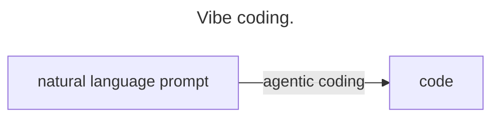

# blog.tinco.nl

A Jekyll blog. Posts live in `_posts/`, the page templates in `_layouts/`. The
site is built into `public/` and served by nginx in a Docker image.

Some styling and the animated "Tinco" header come from the main site:
`https://tinco.nl/tinco.css` and `https://tinco.nl/tinco.js` (repo `tinco.nl`).
Colours for light and dark mode are set in `_layouts/default.html` with
`prefers-color-scheme` and override the dark-only colours in `tinco.css`.
Always link external assets over `https://`, because browsers block `http://`
assets on the https site.

## Diagrams

Write diagrams in posts as fenced ```` ```mermaid ```` blocks. On pages that
contain one, `_layouts/default.html` loads [pele](https://pele.run), pinned
to an exact version with an integrity hash, and renders each block as an SVG
coloured with the blog's light/dark palette. A `title:` in the block's
Mermaid front matter is shown as a caption below the diagram:

````markdown

````

To upgrade pele, change the
version and recompute the hash:

```bash
curl -s https://cdn.jsdelivr.net/npm/pele@VERSION/dist/pele.global.js | openssl dgst -sha384 -binary | openssl base64 -A
```

## Preview locally

Jekyll isn't installed locally, so build with the same Docker image the
Makefile uses, then serve `public/`:

```bash
docker run --rm -v "$PWD":/srv/jekyll jekyll/jekyll:builder jekyll build
```

```bash
python3 -m http.server 4000 -d public
```

Open http://localhost:4000. Posts are at `/YYYY/MM/DD/slug.html`.

While writing, run a server that includes drafts from `_drafts/` and reloads
the browser on every save:

```bash
docker run --rm -v "$PWD":/srv/jekyll -p 4000:4000 -p 35729:35729 jekyll/jekyll:builder jekyll serve --drafts --watch --force_polling --livereload --host 0.0.0.0
```

Drafts get today's date in their URL. To publish one, move it to
`_posts/YYYY-MM-DD-slug.md`.

## Deploy

Production runs on the NixOS server behind `tinco.nl` / `blog.tinco.nl`
(46.224.55.92). Its config is the `nixos-configuration` repo:
`services.nix` defines the systemd unit `blogTincoNl`, which runs the image
`tinco/blog.tinco.nl:latest` behind `nginx-proxy` and the Let's Encrypt
companion. When the unit starts, it runs `docker pull` before `docker run`, so
deploying a new version takes two steps.

1. Build and push the image. You need to be logged in to Docker Hub as `tinco`:

   ```bash
   make docker
   ```

   This builds the site and then builds the image for `linux/amd64`, which is
   the server's architecture; don't drop `--platform` when building on an
   Apple Silicon Mac. Finally it pushes `tinco/blog.tinco.nl:latest`.

2. Restart the service so it pulls the new image:

   ```bash
   ssh -t tinco.nl sudo systemctl restart blogTincoNl
   ```

   `sudo` asks for a password. If that isn't an option (for example, from a
   non-interactive script), stop the container instead. The `tinco` user is in
   the `docker` group, and the unit has `Restart=always`, so systemd restarts
   it and pulls the new image:

   ```bash
   ssh tinco.nl docker stop blog.tinco.nl
   ```

3. Check that it worked:

   ```bash
   ssh tinco.nl 'docker ps --filter name=blog.tinco.nl'
   ```

   Then open https://blog.tinco.nl in light and dark mode.

Commit and push to `master` along with deploying, so master matches what is
live. This repo doesn't use pull requests.
