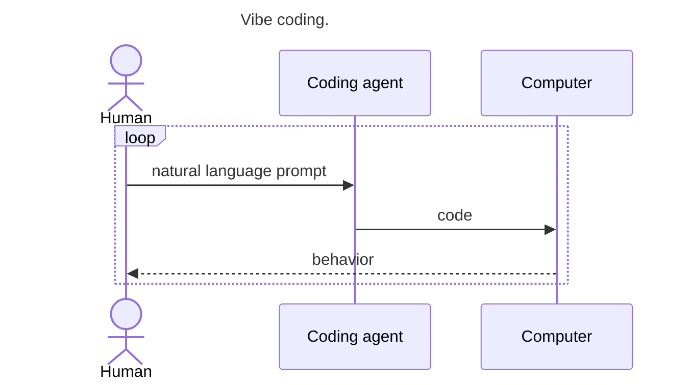
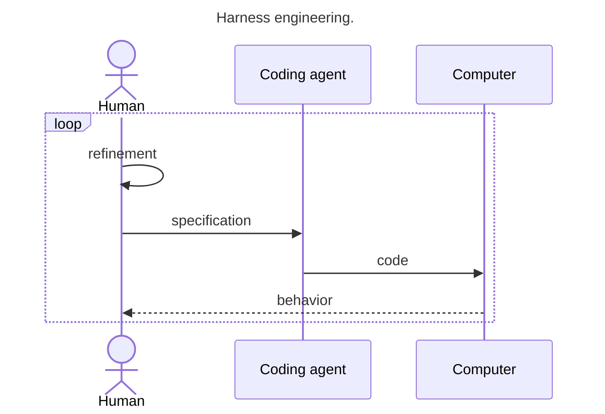
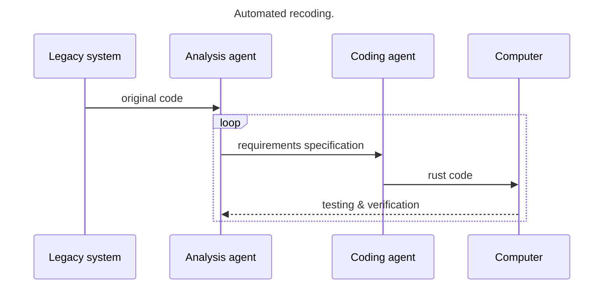
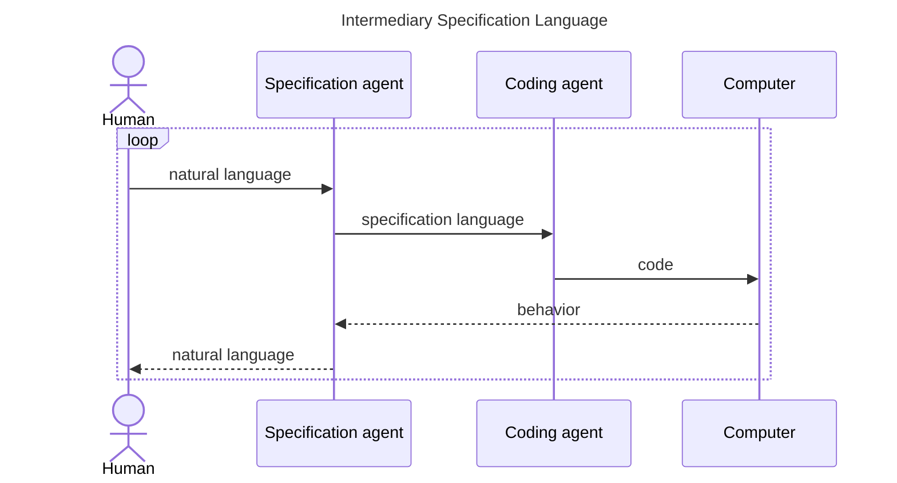

Specification languages and systems are more than just a way for software factories to fit agentic coding to enterprise development processes. They're going to play a key role in the future of programming in general.

The idea that expressing logic in programming languages would eventually no longer be part of our daily jobs has put a melancholic twist on what is the most exciting development in software since probably the internet. Now that our development processes are crystalizing, this feeling of melancholy has started to twist for me into a feeling of anticipation for the next generation of ways in which humans tell computers what to do.



A couple of years ago, when large language machines first started to become good at generating and transforming code this development came as a bit of a bummer for those programmers that love dabbling with and creating niche programming languages. Their secret hope of creating the perfect programming language for humans to talk to computers with was dashed by the idea that in the future humans would simply be prompting agents to do the actual programming.

Over the years we've gradually seen the industry move towards this future. From vibe coding to harness engineering and software factories. A recurring theme is that while you can let an agent accomplish a great deal using a simple prompt, to get an application to actually fit all of its requirements those requirements need to be specified.



Recently the discussion around the usefulness of comfortable programming languages heated up again when the creator of Ruby on Rails came to the same realisation and argued for automated porting of features from Ruby to Rust to accomplish hardware cost savings at the 2026 Rails World Conference. Understandably, this caused some commotion within the Ruby community. What's the use of Ruby, when its chief redeeming quality is supplanted by the use of agentic software development? Another important insight is that when a Ruby codebase already exists, it is markedly easier to have an agent port it to Rust than it is to get an agent to build a full product from scratch. However, do the architectural decisions made for the Ruby codebase influence those of the Rust port? And when the codebase is in Rust, is the codebase still as easy to maintain as it was in Ruby? For humans.. or for agents? There is a definitive element of over specification when using an existing codebase as the source of truth for a new implementation. From architectural decisions to technological choices and other implementation details.

If just prompting Claude Code to do things leads to repetitive under specification of the problem you are trying to solve and typing out the full solution in an expressive language like Ruby or Rust is now considered to be tedious over specification, then what’s the right level of abstraction? The answer to that question is going to shape the future of programming.

With my colleagues I help organisations migrate codebases from legacy platforms with difficult or non-existent upgrade paths like Perl, Delphi, 4GL and Cobol to modern versions of Java, C# or indeed Rust. Engineers at these organisations have spent decades refining their code to best satisfy the needs of their customers and their managers. This code that is spread over different systems and various environments is an expression of the mapping of those business requirements to the hardware and integration constraints. When replatforming the code the requirements and constraints have to be pulled apart and organised in a way that allows them to be reapplied to the new platform.

<a class="link-card" href="https://openai.com/index/harness-engineering/">
  openai.com · February 2026
  Harness engineering: leveraging Codex in an agent-first world
  How an OpenAI team built and shipped a product where every line of code was written by Codex.
</a>

At the start of the year OpenAI published an influential article on a new way of working they had been successful with for a green field project and that had been gaining traction at various enterprises in the preceding months. They call this practice “harness engineering” but it’s also known as spec driven development. When following this process instead of typing a prompt directly to the agent, you spend time refining a specification of the work the agent should do before sending it out. Typically this specification stays present in your repository to serve as a reference for agents to base their decisions on for future features and modifications.

## Levels of specification

So far, we have identified three major methods of agentic coding processes:

Ordered from being at risk of under specification to being at risk of over specification. When transforming existing code to a new language, you are dealing with over specification. The original Ruby code does not only specify the business rules, it also specifies the architecture, the technologies and libraries to use, the algorithms and all sorts of implementation details that might or might not be relevant to the final Rust implementation.

On the vibe coding side, there is under specification. Not only does the natural language prompt probably not include literally all business rules, acceptance criteria, performance requirements, maintenance concerns and user preferences, it usually leaves the agentic coding system to decide the architecture, the technologies and libraries, the algorithms and all the other implementation details that might or might not affect the quality of the final Rust implementation.

In the harness engineering process there’s risk of both under specification and over specification. Not long after OpenAI published their article and the accompanying project, critics remarked that the claims of the project being fully autonomously coded were overwrought as explicit algorithms and architectural decisions were embedded in the specification.

From conversations with fellow software engineers I have learned that most of us are on a spectrum somewhere between these three. Sometimes depending on whether the project is mostly greenfield or mostly brownfield or indeed a full rewrite of an existing project. I also learned that many are uncertain the process they've adopted is actually the most effective or most efficient way, it's simply the process they've rolled into that fit their needs and amplified their capabilities.

## The future paradigm

If a single interaction pattern is going to be the future of programming, then that interaction pattern must have the following properties:

1. It should consistently result in functionally correct code that meets secondary requirements like performance, resource usage and usability.
2. It should accomplish the above two functionalities at an abstraction level that is as close as possible to the expression of business requirements in natural language.
3. It should allow the operator to modify the code without requiring knowledge of implementation details such as implementation language, architecture or algorithms.

Property 1 is what we ask of every computer programming platform. Whatever language or system we’re building it should allow us to meet our primary objectives predictably.  Property 2 is the traditional requirement we put on ease of use oriented programming languages. Property 3 is the property that evolves in every jump in level of abstraction. The first time the operator was relieved of having to do binary translation in their head. Then later the operator no longer needed to know the specific processor instructions, and so on. In this iteration of the property, the ambition is that the agentic process allows us to fully decouple business requirements from platform specific detail.

We are just on the cusp of a new programming language paradigm, however one with an interesting twist. Like when we went from punch cards to keyboards and monitors, there is also a revolution in the way we operate interface with our programming environment. The programming languages of the future are not only going to be steering agents into writing code, they themselves are going to be generated and modified by agents. No modern software developer is going to sit around and learn a new programming language, let alone use it to type out business requirements. Agents are going to be writing this new programming language, and we are going to be communicating with them to ensure those business requirements get encoded correctly.

To make sure the final code is consistently correct, the language must help prevent under specification. However to allow its work to be easily inspected and iterated upon without exposing implementation detail it should be minimally over specified. And then finally it should be easy for an agent to translate this language consistently to and from natural language as part of its interaction model with the operator. This is the challenge for the programming language designers of the future, and I’m excited to find out what we’re going to be coming up with.

## Some light reading

There's various efforts already out there that either tackle this problem directly or address parts of it:

Spec-driven development toolkits like [OpenSpec](https://openspec.dev/) and [SpecKit](https://github.com/github/spec-kit).

There's interesting alternative ways of describing software such as [Alloy](https://alloytools.org/), old school ones such as [Cucumber](https://cucumber.io/) and of course various verification tools like [TLA+](https://en.wikipedia.org/wiki/TLA%2B) and [LEAN](https://lean-lang.org/). At [Bosun](https://bosun.ai/) we're embedding verification into specs using our own [Parity](https://blog.bosun.ai/cobol-rust-intent/).

I've been particularly fascinated by the articles in the sphere of Jackson and Meng like [Making Software Meaningful](https://arxiv.org/html/2606.11051v1) and [What You See Is What It Does](https://arxiv.org/abs/2508.14511).

Let me know what you think is going to be the future of programming!

[Discuss on HN](https://news.ycombinator.com/item?id=50208611)
